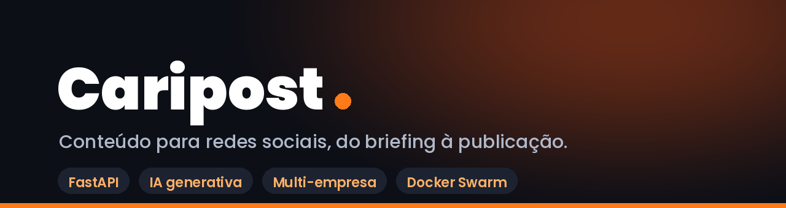

<p align="center">
  
</p>

<h1 align="center">Caripost</h1>

<p align="center">
  Plataforma SaaS que leva o conteúdo de redes sociais do briefing à publicação:
  cadastro de marcas, motor criativo com IA, agenda editorial e publicação.
</p>

<p align="center">
  
  
  
  
  
</p>

<p align="center">
  <a href="#sobre">Sobre</a> &middot;
  <a href="#recursos">Recursos</a> &middot;
  <a href="#arquitetura">Arquitetura</a> &middot;
  <a href="#início-rápido">Início rápido</a> &middot;
  <a href="#deploy">Deploy</a> &middot;
  <a href="#documentação">Documentação</a>
</p>

---

## Sobre

**Caripost** é um painel multi-empresa para agências e times de marketing. Cada cliente tem sua
identidade visual, produtos, planos/subprodutos e base de conhecimento; o motor criativo usa esses
dados para gerar arte e texto no tom da marca — e não no tom genérico de um modelo de IA.

O ciclo completo vive dentro da plataforma:

```text
cadastro da marca  →  briefing  →  geração (texto + arte/vídeo)  →  revisão  →  agenda  →  publicação
```

Produção: `caripost.cariap.com.br` e `caripost.n8nmikael.com.br`.

## Recursos

| Área | O que faz |
| --- | --- |
| **Clientes e marcas** | Empresas, produtos, planos e subprodutos com objetivo comercial, benefícios, paleta, logos, redes e base de conhecimento (PDF/TXT). |
| **Motor criativo** | Post, story, carrossel editorial e vídeo. O briefing seleciona plano e adicionais por ID e só injeta o que foi marcado. |
| **Estúdio de imagem** | Modo por referência (arte inteira pela IA) e compositor próprio em PIL com design tokens por empresa. |
| **Vídeo** | Roteiro estruturado, personagem consistente, continuidade por frame e camada de marca/CTA por empresa. |
| **Mídia** | Upload e catálogo, transcrição PT-BR, edição de SRT, tradução e queima de legenda via FFmpeg. |
| **AutoEditor / Enhancer** | Cortes automáticos e realce de vídeo. |
| **Operação** | Agenda editorial, publicador para redes sociais, tendências, financeiro e portal do cliente. |
| **Multi-tenancy** | Duas categorias de conta (cliente final e agência), feature flags e escopo por empresa. |

## Arquitetura

| Camada | Stack | Caminhos |
| --- | --- | --- |
| API | FastAPI 0.133 · Python 3.12 · SQLite · FFmpeg · boto3 | [`app/main.py`](app/main.py), [`app/routers/`](app/routers/), [`app/services/`](app/services/) |
| Caripost OS | JSX servido pela própria API | [`app/os/`](app/os/) |
| Painel legado | HTML/CSS/JS vanilla, embutido no OS | [`app/ui/`](app/ui/) |
| Portal do cliente | React · Vite | [`frontend-portal/`](frontend-portal/) |
| Motor de arte | PIL + tokens de design | [`app/services/template_composer.py`](app/services/template_composer.py), [`app/services/video_composer.py`](app/services/video_composer.py) |
| Storage | MinIO / S3 | `S3_*` no ambiente |
| Deploy | Docker Swarm + Traefik | [`Dockerfile`](Dockerfile), [`deploy/`](deploy/) |

### Migrations

Runner próprio com `flock` e ledger `schema_migrations` em [`app/migrations.py`](app/migrations.py) —
roda no boot, é idempotente e não depende de ferramenta externa.

### Autenticação

Fail-closed: sem `CARIPOST_API_KEY` e sem sessão válida a API rejeita. Acesso aberto exige opt-in
explícito (`ALLOW_OPEN_ACCESS=1`, só desenvolvimento). Endpoints públicos legítimos (`/health`,
callbacks OAuth) são isentos.

## Início rápido

### Pré-requisitos

- Python 3.12, FFmpeg e as dependências de [`requirements.txt`](requirements.txt)
- Docker (para build/deploy) e um bucket S3/MinIO

### Local

```bash
python3 -m venv .venv && source .venv/bin/activate
pip install -r requirements.txt

export CARIPOST_API_KEY="uma-chave-forte"
export AUTH_SESSION_SECRET="outro-segredo"
export CARIPOST_MEDIA_ROOT="$PWD/data/media"

uvicorn app.main:app --host 0.0.0.0 --port 8765 --reload
```

Interfaces: `http://localhost:8765/os/index.html` (Caripost OS) e `http://localhost:8765/ui/`
(painel legado).

### Testes

```bash
pytest tests -q
python3 docs/marcos/regressao_check.py   # golden determinístico do motor criativo, sem IA
```

> O `regressao_check.py` é obrigatório antes e depois de mexer em `template_composer.py` ou
> `routers/posts.py`: só podem mudar as telas que você quis mudar.

## Deploy

Produção roda em Docker Swarm atrás do Traefik. O deploy é feito por atualização de imagem do
serviço — **nunca** por redeploy de stack, que não carrega as chaves setadas via `--env-add`:

```bash
docker build -t caripost:<versão> .
docker service update --image caripost:<versão> metaporn-new_adult-meta
```

Ao subir uma versão, as três strings de versão andam juntas: `app/main.py` (`version=`),
`app/os/apps-manage.jsx` (`MP_OS_VERSION`) e o `?v=` em `app/os/index.html` — sem o cache-bust o
navegador serve JSX antigo.

Exemplos de stack em [`deploy/`](deploy/).

## Variáveis de ambiente

| Variável | Para que serve |
| --- | --- |
| `CARIPOST_API_KEY` | Chave da API; também é base do fallback de criptografia. |
| `AUTH_SESSION_SECRET` | Assinatura das sessões de login. |
| `CARIPOST_ENCRYPTION_KEY` | Chave Fernet para credenciais e cookies salvos. |
| `CARIPOST_MEDIA_ROOT` / `CARIPOST_MEDIA_URL_SECRET` | Raiz da mídia local e assinatura das URLs. |
| `CARIPOST_DB_PATH` | Caminho do SQLite. |
| `PORTAL_JWT_SECRET` | Tokens do portal do cliente. |
| `S3_ENDPOINT_URL`, `S3_BUCKET`, `S3_ACCESS_KEY_ID`, `S3_SECRET_ACCESS_KEY`, `S3_PUBLIC_BASE_URL` | Storage de mídia. |

Modelo completo em [`deploy/stack.example.yml`](deploy/stack.example.yml).

## Estrutura

```text
app/
  main.py            API principal e endpoints legados
  migrations.py      Runner de migrations com ledger
  routers/           REST por domínio (companies, posts, portal, dmca, …)
  services/          Motor criativo, vídeo, publicação, calendário, e-mail
  publishers/        Drivers de publicação por plataforma
  os/                Caripost OS (JSX)
  ui/                Painel legado
frontend-portal/     Portal do cliente (React + Vite)
creative_engine/     Templates e recursos do motor criativo
deploy/              Stacks Swarm e arquivos de infra
docs/                Documentação (produto, engenharia, deploy, marcos)
tests/               Testes
```

## Documentação

- [`docs/produto/`](docs/produto/) — visão de produto, pipeline de produção.
- [`docs/engenharia/`](docs/engenharia/) — legendas, prompts, geração de arte, checklists.
- [`docs/deploy/`](docs/deploy/) — deploy, diagnóstico e infraestrutura de transcrição.
- [`docs/marcos/`](docs/marcos/) — entregas por marco, aprendizados e padrões do motor criativo.
- [`CHANGELOG.md`](CHANGELOG.md) — histórico versionado.
- [`CONTRIBUTING.md`](CONTRIBUTING.md) e [`SECURITY.md`](SECURITY.md).

## Herança do projeto

O Caripost nasceu como **MetaPorn/adult-meta**, voltado a agências de conteúdo adulto. Os nomes de
infra daquela fase continuam em produção de propósito — renomeá-los criaria volumes, rede e bucket
novos e derrubaria dados:

| Item | Nome real hoje |
| --- | --- |
| Serviço Swarm | `metaporn-new_adult-meta` |
| Imagem | `adult-meta` |
| Bucket MinIO | `metaporn` |
| Envs em produção | `ADULT_META_*`, `METAPORN_ENCRYPTION_KEY` |

O código lê `CARIPOST_*`; [`app/__init__.py`](app/__init__.py) espelha os dois prefixos antes de
qualquer módulo ler `os.environ`, e `CARIPOST_ENCRYPTION_KEY` aceita `METAPORN_ENCRYPTION_KEY` como
fallback. Módulos daquela fase (DMCA, publisher Pornhub, prompts de transcrição adulta) ainda
existem e estão marcados para revisão.

## Segurança

Nunca versionar `.env`, `deploy/stack.yml` real, bancos, mídia, tokens ou dados de clientes.
Detalhes e canal de reporte em [`SECURITY.md`](SECURITY.md).

## Licença

Proprietário — todos os direitos reservados. Uso, cópia, distribuição e deploy dependem de
autorização expressa do titular. Ver [`LICENSE`](LICENSE).
